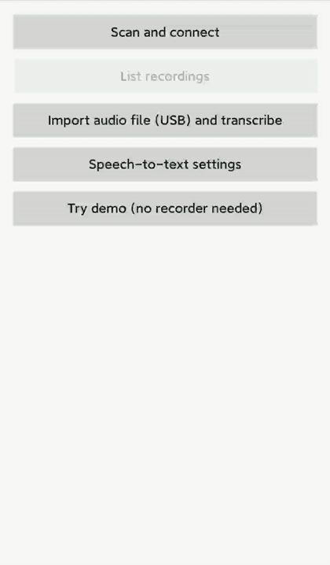

# WB-RC100 AI voice recorder card — open BLE protocol and Android sample

WB-RC100 is a card-sized AI voice recorder (86 × 54 × 3.2 mm) with a documented Bluetooth LE protocol.
This repository contains the free protocol document and a plain-Java Android sample app that connects to the card,
downloads recordings (with resume), plays them, transcribes them with any OpenAI-compatible speech-to-text API,
shares them and deletes them from the card, so you can build your own AI note-taker app without our cloud.
**No license fee, no royalties, no per-device fee.**

*The Android sample with a real card on a Xiaomi Mi 6 (Android 9): connect, read device info, list, download and transcribe a 58-second phone call the card recorded in call mode. The transcript (in Chinese, a bank's automated phone menu) comes from OpenAI speech-to-text, entered in the app's settings.*

- 📄 [BLE protocol, sample edition](docs/ble-protocol.md): GATT, frame format, every command for list / download / delete, audio format, timeouts
- 🌐 [Web demo](https://snugogo.github.io/ai-recorder-card-sdk/web-demo/): connect a card from Chrome or Edge (Web Bluetooth), list, download with pause and resume, play and save. Has a no-card demo too
- 📱 [Android sample](android-sample/): scan, connect, list, download with resume, play, transcribe, share, delete, import from USB. Plain Java, no third-party libraries, builds an APK
- ❓ [FAQ](docs/faq.md)
- 🛒 Buy a card to test: **USD 55 per sample card, shipping included**. Order and developer page: https://aihwstack.com/en/products/recorder/developer/

## Specs

| | |
|---|---|
| Size | 86 × 54 × 3.2 mm (credit-card size) |
| Bluetooth | BLE GATT, service `0xAE20`; write `0xAE21`; notify `0xAE22` / `0xAE23`; no pairing or authorization |
| Audio | Opus 16 kbit/s mono (optional WAV); 1 hour ≈ 7.2 MB |
| Download | ≈ 31 KB/s; a 1-hour recording in about 4 minutes |
| Storage | Sample cards: 32 GB, about 255 hours with the current firmware (it stores Opus + WAV). Volume orders: up to 512 GB, and Opus-only firmware (about 4,300 hours per 32 GB) |
| Platforms | Same protocol on Android and iOS |
| Transcription | Your choice: any OpenAI-compatible speech-to-text service; your key stays on your phone |

## Try it without a card

Install the APK from [Releases](https://github.com/snugogo/ai-recorder-card-sdk/releases) (Android 6.0 or later) and tap **Try demo (no recorder needed)**.
A recording made on a real card is built in: Download, Play, Transcribe, Share and Delete run the same code as with a card.
Without a speech-to-text service set up, Transcribe shows the sample's transcript; with one, it transcribes the audio for real.

The APK is signed with a key used only for this sample. Certificate SHA-256:
`81:5B:11:12:3D:8E:92:64:53:17:3F:16:92:06:65:F5:10:93:57:A1:BD:EF:56:C9:44:A6:AD:49:0F:3A:0B:FE`

Or open the [web demo](https://snugogo.github.io/ai-recorder-card-sdk/web-demo/) and tap **Try demo (no card needed)**: no install, any browser. Its source is one HTML file, [`web-demo/index.html`](web-demo/index.html).

## Quick start (Android)

1. Install the APK from Releases, or open `android-sample/` in Android Studio (AGP 8.2, compileSdk 34, minSdk 23) and run it on a phone.
2. Switch the recorder on. Tap **Scan and connect** → battery, firmware, storage and device ID appear.
3. Tap **List recordings**. Each recording has **Download**, **Play**, **Transcribe**, **Share** and **Delete**.
4. **Download** resumes from the last byte if the link drops (reconnect and tap it again).
5. **Import audio file (USB)**: connect the card to the phone with a USB data cable; it appears as a USB drive (USB 2.0).
   Pick a recording in the system file picker and it is transcribed. Some cables only charge and carry no data.
6. **Transcribe** asks once for base URL, API key and model of any OpenAI-compatible speech-to-text service. The key is stored only on the phone; long recordings are sent in 10-minute pieces.
7. **Share** sends the recording as an `.ogg` file to any app (mail, chat, cloud drive), with the transcript as text if there is one.

Source: `Protocol.java` (frames, CRC, list parsing), `OggOpus.java` (wraps the card's bare Opus packets into Ogg; also fixes playback on Android 9),
`Transcriber.java` (speech-to-text), `ShareProvider.java` (hands files to other apps), `MainActivity.java` (Bluetooth, UI and demo mode).
`assets/demo-sample.opus` is a 42-second recording exactly as the card stores it (2,123 bare 40-byte Opus packets): a handy test file for your own parser.
To build a signed release yourself, see the comment in `app/build.gradle`; no key is stored in this repository.

On Android 6–11, allow Location and switch Location on, otherwise Bluetooth scanning finds nothing.

## Tested with a real card

Card firmware V1.0.0, November 2026:

| | Device | Tested |
|---|---|---|
| Android sample 1.1.0 | Xiaomi Mi 6, Android 9 | Connect, device info, list, download, resume after an interrupted download (same bytes as a full download), play, transcribe (also a 30-minute recording sent in 10-minute pieces), share, delete from the card, demo mode |
| Web demo | Chrome on Windows 11 | Connect, device info, list, download, pause and resume, play, save `.ogg` |
| Card as a USB drive | Windows 11 PC, iPhone (Files app) | The card shows up as a USB drive |

On a PC the web demo downloads more slowly than the phone app, because the browser cannot ask for a faster Bluetooth connection.
Step-by-step results and screenshots: [docs/tested.md](docs/tested.md).

## What is free, and what comes with an order

You can build a working app from this repository alone. The paid tiers save you time; they do not unlock the device.

| | Free (this repo) | Sample order (from 1 card) | Hardware order (100–999 cards) | Developer package (1,000+ cards) | Your brand (1,000+ cards) |
|---|---|---|---|---|---|
| Protocol | Sample edition | Sample edition | Sample edition | Order edition: real-time audio, recording control, reconnect with recovery of missed audio, segment download, mic gain | — |
| Code | Android sample app: download with resume, play, transcribe, share, delete | Plus the complete reference app source (developer version, Android only) | Same as a sample order | Plus order-edition source and APK, and a Chrome Web Bluetooth demo | Our published app under your brand (its source is not provided) |
| Help | GitHub Discussions and Issues | Self-service: full docs and source, plus GitHub Discussions | Self-service: full docs and source, plus GitHub Discussions | Dedicated engineering support from our team | — |
| License fee / royalties | None | None | None | None | 10 % revenue share, no license fee |

You can start with 100 cards; the full developer package and engineering support start at 1,000 units.
A sample card costs **USD 55, shipping included**. Prices and current terms: https://aihwstack.com/en/products/recorder/developer/

## How this compares with closed SDKs

Some recorder vendors ship only a compiled SDK (`.aar` / `.framework`), require a partner account and bind each device to their app,
and charge per transcription minute or per connected device. Here you get the byte-level protocol and readable source,
recordings never pass through our servers, and there is no per-device fee.

## License and use with other hardware

- **Code** (`android-sample/`): [MIT](LICENSE). You may use, change and sell it, also with hardware you did not buy from us.
  The one condition: keep the copyright and license notice in your copy of the code.
- **Documentation** (`docs/`): [CC BY 4.0](https://creativecommons.org/licenses/by/4.0/). Reuse it freely with attribution:
  "AI HW Stack, https://aihwstack.com".
- **Names and logos**: "WB-RC100" and "AI HW Stack" are not licensed by this repository. Do not use them to name your product
  or to suggest that we made or endorse it.
- **Services are for cards bought from us**: engineering support, order-edition materials and the brand option
  come only with recorder cards bought from us. The code and documentation licenses above are not limited this way.
- **No warranty, tested hardware only**: the protocol and sample are tested on cards we ship (firmware V1.0.0).
  Cards from other sources may run different firmware; we cannot support them.
